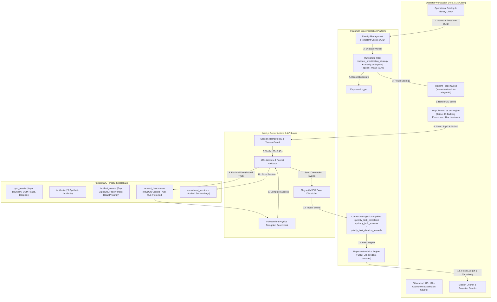
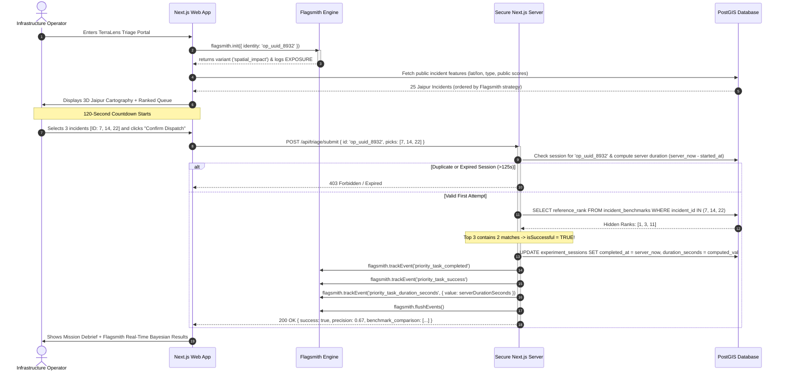

<div align="center">

# 🌐 TerraLens
### *Don't just find the worst problem. Find the problem that matters most.*

**Enterprise Spatial Decision Intelligence Platform Powered by Flagsmith Experimentation**  
*Testing whether contextual GIS heuristics improve high-stakes infrastructure emergency triage over traditional technical severity.*

[](https://flagsmith.com)
[](https://docs.flagsmith.com/basic-features/managing-features)
[](https://nextjs.org)
[](https://postgis.net)
[](https://maplibre.org)
[](https://www.typescriptlang.org)

<p align="center">
  <a href="#-flagsmith-as-the-core-decision-engine">Flagsmith Core Engine</a> •
  <a href="#-executive-summary">Executive Summary</a> •
  <a href="#-the-decision-crisis-in-infrastructure-ops">The Decision Crisis</a> •
  <a href="#-scientific-experiment-design">Experiment Design</a> •
  <a href="#-deep-dive-flagsmith-architecture--event-pipeline">Flagsmith Architecture</a> •
  <a href="#-end-to-end-system-diagrams">System Diagrams</a> •
  <a href="#-yair-titelboim-inspired-cartography">3D Cartography</a> •
  <a href="#-mathematical-ranking-formulations">Mathematical Models</a> •
  <a href="#-independent-ground-truth-benchmark">Ground-Truth Benchmark</a> •
  <a href="#-database-schema--postgis">Database & PostGIS Schema</a> •
  <a href="#-installation--setup-guide">Setup Guide</a>
</p>

---

</div>

## ⚡ Flagsmith as the Core Decision Engine

> **Notice:** TerraLens is not a standard web application with a feature flag bolted on as an afterthought.  
> **Flagsmith is the nervous system of the entire platform.**

Every algorithmic queue sort, every telemetry view, every identity bucketing decision, and every statistical conversion event flows through the **Flagsmith Experimentation & Analytics Engine**:

```
                               ┌────────────────────────────────────────────────┐
                               │           OPERATOR ENTERS TERRALENS            │
                               └───────────────────────┬────────────────────────┘
                                                       │
                                   1. Generate Secure Stable Identity
                                      UUIDv4 (Stored in HttpOnly Cookie)
                                                       │
                                                       ▼
                               ┌────────────────────────────────────────────────┐
                               │           FLAGSMITH IDENTITY RESOLUTION        │
                               │      flagsmith.identify(participant_uuid)      │
                               └───────────────────────┬────────────────────────┘
                                                       │
                           Evaluates Multivariate Flag: incident_prioritization_strategy
                                                       │
                         ┌─────────────────────────────┴─────────────────────────────┐
                         │ (50% Traffic Split)                                       │ (50% Traffic Split)
                         ▼                                                           ▼
       ┌───────────────────────────────────┐                       ┌───────────────────────────────────┐
       │     VARIANT A: severity_only      │                       │     VARIANT B: spatial_impact     │
       ├───────────────────────────────────┤                       ├───────────────────────────────────┤
       │ Dispatches raw technical sorting  │                       │ Dispatches multi-criteria GIS     │
       │ S_A = Technical Severity          │                       │ S_B = Severity x (0.55 + 0.45C)   │
       │ Formula: S_A = Sev                │                       │ Evaluates Pop, Facilities, Roads  │
       └─────────────────┬─────────────────┘                       └─────────────────┬─────────────────┘
                         │                                                           │
                         └─────────────────────────────┬─────────────────────────────┘
                                                       │
                                  2. Automatic Exposure Logging
                                     Flagsmith SDK logs Exposure Event
                                                       │
                                                       ▼
                               ┌────────────────────────────────────────────────┐
                               │             120s TRIAGE SIMULATION             │
                               │    Operator selects exactly 3 emergencies      │
                               └───────────────────────┬────────────────────────┘
                                                       │
                                                       ▼
                               ┌────────────────────────────────────────────────┐
                               │       SERVER-SIDE VALIDATION & BENCHMARK       │
                               │  - Enforces 120s hard cut-off                  │
                               │  - Evaluates vs. Hidden Ground Truth           │
                               │  - Computes: Success, Precision@3, NDCG@3      │
                               └───────────────────────┬────────────────────────┘
                                                       │
                                  3. Flagsmith Multi-Metric Conversion Pipeline
                                                       │
                         ┌─────────────────────────────┼─────────────────────────────┐
                         ▼                             ▼                             ▼
       ┌───────────────────────────────────┐ ┌───────────────────────────────────┐ ┌───────────────────────────────────┐
       │     priority_task_completed      │ │       priority_task_success       │ │ priority_task_duration_seconds  │
       ├───────────────────────────────────┤ ├───────────────────────────────────┤ ├───────────────────────────────────┤
       │ Type: Conversion Count            │ │ Type: Binomial Conversion Rate    │ │ Type: Continuous Mean (Numeric)   │
       │ Fires for every valid submission  │ │ Fires ONLY if Top-3 overlap >= 2  │ │ Captures duration in seconds      │
       └───────────────────────────────────┘ └───────────────────────────────────┘ └───────────────────────────────────┘
                                                       │
                                                       ▼
                               ┌────────────────────────────────────────────────┐
                               │     FLAGSMITH BAYESIAN EXPERIMENT WAREHOUSE    │
                               │  - Computes Conversion Lift (%)                │
                               │  - 95% Bayesian Credible Intervals             │
                               │  - Probability to Beat Control (P2BC)          │
                               │  - Live Interactive Analytics Telemetry        │
                               └────────────────────────────────────────────────┘
```

---

## 📌 Executive Summary

Municipal and utility infrastructure operators face critical operational overload: water main ruptures, electrical transformer fires, gas pipeline pressure drops, and arterial sinkholes often cascade simultaneously. Traditional dispatch and supervisory control systems rank incoming alerts strictly using **technical severity** (e.g., barometric drop, voltage surge magnitude, SCADA alarm code).

However, technical severity is **spatially blind**:
- **Incident A:** Technical Severity = $94/100$, located in an uninhabited peripheral industrial storage depot.
- **Incident B:** Technical Severity = $76/100$, located directly adjacent to a 750-bed multi-specialty trauma hospital, 3 primary schools, and a dense residential grid during morning peak hours.

Traditional systems place **Incident A at the top of the queue**, directing municipal dispatchers to clear the isolated alarm first. The human, societal, and physical consequences demand immediate intervention at **Incident B**.

**TerraLens** solves this by bridging **PostGIS Spatial Analytics** with **Flagsmith Experimentation**. Instead of assuming spatial intelligence improves decisions, TerraLens uses Flagsmith to scientifically prove it through randomized, controlled, double-blind operator triage trials.

---

## 🎯 The Decision Crisis in Infrastructure Ops

```
TRADITIONAL SEVERITY-ONLY TRIAGE (FLAGSMITH VARIANT A)
[1] 🚨 Incident #04: Isolated Depot Pipeline Leak (Severity: 94)  <-- DISPATCHED FIRST (Low Impact!)
[2] 🚨 Incident #12: Substation Voltage Anomaly   (Severity: 88)
[3] 🚨 Incident #09: Rural Feeder Outage          (Severity: 82)
...
[8] ⚠️ Incident #18: Hospital Corridor Water Main  (Severity: 76)  <-- BURIED IN QUEUE (Catastrophic!)

TERRALENS CONTEXTUAL SPATIAL TRIAGE (FLAGSMITH VARIANT B)
[1] 🚨 Incident #18: Hospital Corridor Water Main  (Context Score: 95.4) <-- PROMOTED BY SPATIAL MODEL!
[2] 🚨 Incident #12: Substation Voltage Anomaly   (Context Score: 89.2)
[3] 🚨 Incident #21: Central Market Gas Pressure   (Context Score: 86.8)
...
[19] ⚪ Incident #04: Isolated Depot Pipeline Leak (Context Score: 52.1) <-- DE-PRIORITIZED
```

---

## 🔬 Scientific Experiment Design

### 1. The Formal Hypotheses
* **Primary Alternative Hypothesis ($H_1$):**  
  Human operators exposed to the **Spatial Context Prioritization Strategy** (`spatial_impact`) via Flagsmith achieve a meaningfully higher triage task success rate ($\ge 2$ of their 3 choices matching the independent physical benchmark's top-3 incidents) compared to operators exposed to **Severity-Only Prioritization** (`severity_only`), demonstrated by a positive posterior conversion lift and high Probability to Beat Control (P2BC) under Flagsmith's Bayesian experimentation model.
* **Null Hypothesis ($H_0$):**  
  There is no meaningful difference in triage success rates between operators using the `spatial_impact` strategy and those using the `severity_only` strategy; the 95% Bayesian credible interval for conversion lift spans zero or indicates equivalence.

> **Methodological Note on Sample Size:** In short-duration pilots or hackathon trial runs, sample sizes (typically $N \approx 30\text{–}60$) may not reach conclusive Bayesian convergence. TerraLens presents honest posterior distributions, credible intervals, and sample counts without fabricating data or claiming certainty prematurely.

### 2. Experimental Controls
To maintain strict laboratory validity:
1. **Identical Visual Canvas:** Both groups receive the exact same 3D cartographic interface, map layers, incident pins, and incident detail inspector.
2. **Identical Incident Dataset:** Exactly the same 25 incidents in Greater Jaipur.
3. **Identical Task & Time Limit:** Both groups must select their top 3 critical emergencies within a synchronized 120-second countdown.
4. **Isolated Independent Benchmark:** The reference ground truth is computed server-side via physical disruption models and is **never** sent to the client. Variant B's algorithm is mathematically distinct from the benchmark to prevent circular bias.
5. **Persistent Zero-Leak Assignment:** Flagsmith binds the participant's anonymous UUID to their variant; page refreshes, back buttons, or re-entries cannot change the assigned variant or allow duplicate submissions.

---

## 🛠️ Deep Dive: Flagsmith Architecture & Event Pipeline

### 1. Flagsmith Multivariate Flag Definition
Within the Flagsmith Cloud Project, the core experiment is governed by:
* **Feature Flag Name:** `incident_prioritization_strategy`
* **Feature Type:** Multivariate Feature Flag
* **Description:** Controls the algorithmic sorting and contextual telemetry calculation for incoming infrastructure alerts.

```json
{
  "name": "incident_prioritization_strategy",
  "type": "MULTIVARIATE",
  "default_enabled": true,
  "initial_value": "severity_only",
  "multivariate_options": [
    {
      "value": "severity_only",
      "percentage_allocation": 50,
      "description": "Control: Strict descending sort by technical severity score"
    },
    {
      "value": "spatial_impact",
      "percentage_allocation": 50,
      "description": "Treatment: Contextual sort integrating population, critical facilities, and road network"
    }
  ]
}
```

### 2. Flagsmith Conversion Metrics Configuration
Three distinct metrics are defined in Flagsmith to measure different facets of operator behavior:

| Metric Name in Flagsmith | Type | Aggregation | Trigger Condition |
| :--- | :--- | :--- | :--- |
| **`priority_task_completed`** | Count | Total Events | Dispatched whenever an operator successfully submits a valid 3-incident dispatch within 120s. |
| **`priority_task_success`** | Binomial | Proportion (%) | Dispatched **only** if the server-side validator confirms the operator selected at least 2 of the top 3 benchmark incidents. |
| **`priority_task_duration_seconds`** | Continuous | Numeric Mean | Carries the exact floating-point duration `{ value: seconds }` taken by the operator to decide and submit. |

### 3. Implementation in Code

#### Client-Side Initialization & Exposure Tracking
```typescript
import flagsmith from 'flagsmith';

// Initialize Flagsmith with stable participant identity
export async function initOperatorSession(participantId: string) {
  await flagsmith.init({
    environmentID: process.env.NEXT_PUBLIC_FLAGSMITH_ENVIRONMENT_KEY!,
    identity: participantId, // Stable UUID ensures persistent variant bucketing
    cacheFlags: true,
    enableAnalytics: true,
    onChange: (oldFlags, params) => {
      console.log('Flagsmith flags synchronized for operator:', participantId);
    }
  });

  // Evaluate the multivariate flag
  const strategyVariant = flagsmith.getValue('incident_prioritization_strategy');
  
  // Flagsmith automatically logs an Exposure event for this identity
  return strategyVariant as 'severity_only' | 'spatial_impact';
}
```

#### Server-Side Validation & Event Ingestion
```typescript
import flagsmith from 'flagsmith-nodejs';

export async function processTriageSubmission({
  participantId,
  selectedIncidentIds
}: {
  participantId: string;
  selectedIncidentIds: number[];
}) {
  // 1. Fetch Session Record & Enforce Server-Side Time Limit
  const session = await db.getExperimentSession(participantId);
  if (!session || session.completed_at) {
    throw new Error('Invalid or already completed session');
  }

  const serverNow = new Date();
  const serverStartedAt = new Date(session.started_at);
  const serverDurationSeconds = (serverNow.getTime() - serverStartedAt.getTime()) / 1000;

  // Enforce 120s limit (+ 5s network grace) based strictly on server clock
  if (serverDurationSeconds > 125) {
    throw new Error('Triage response window exceeded 120s limit');
  }

  // 2. Fetch Hidden Server Ground Truth from PostGIS
  const benchmarkTop3 = await getGroundTruthBenchmarkTop3();
  const matches = selectedIncidentIds.filter(id => benchmarkTop3.includes(id));
  const isSuccessful = matches.length >= 2;

  // 3. Persist Completed Session to Database with Server Timestamps
  await db.completeExperimentSession({
    participantId,
    completedAt: serverNow,
    durationSeconds: serverDurationSeconds,
    selectedIncidentIds,
    isSuccessful
  });

  // 4. Dispatch Verified Conversion Events to Flagsmith SDK
  await flagsmith.identify(participantId);

  // Conversion Metric 1: Task Completed (Count)
  await flagsmith.trackEvent('priority_task_completed');

  // Conversion Metric 2: Scientific Task Success (Proportion)
  if (isSuccessful) {
    await flagsmith.trackEvent('priority_task_success');
  }

  // Conversion Metric 3: Decision Duration (Continuous Mean)
  await flagsmith.trackEvent('priority_task_duration_seconds', {
    value: serverDurationSeconds
  });

  await flagsmith.flushEvents();

  return { success: isSuccessful, matches: matches.length, duration: serverDurationSeconds };
}
```

---

## 📊 End-to-End System Diagrams

### 1. Complete Architecture Flowchart



---

### 2. Flagsmith Data Flow & Sequence Diagram



---

## 🗺️ Yair Titelboim-Inspired Cartography

Inspired by urban researcher and cartographer **Yair Titelboim** (*Infrastructure Research*), TerraLens features an immersive **Cyber-Physical Operations Center**:

```
 ┌────────────────────────────────────────────────────────────────────────┐
 │ TERRALENS // CRITICAL INFRASTRUCTURE DECISION INTELLIGENCE             │
 │ JURISDICTION: JAIPUR METROPOLITAN REGION (EPSG:32643 / WGS84)          │
 ├────────────────────────────────────────┬───────────────────────────────┤
 │  3D POSTGIS VECTOR CANVASES           │  FLAGSMITH STRATEGY: TREATMENT│
 │                                        │  VARIANT: spatial_impact      │
 │   [3D Extruded Building Layer]         ├───────────────────────────────┤
 │   • SMS Medical Enclave (Height: 45m)  │  [1] COMPOSITE SCORE: 96.2    │
 │   • Secretariat Government Complex     │      INCIDENT #08: GAS MAIN   │
 │   • Walled City High-Density Blocks    │      Sev: 82 | Pop Exp: 18.4k │
 │                                        │      Near: 2 Hosp, 4 Schools  │
 │   [Hexagonal Population Grid]          │      [✓ SELECTED FOR DISPATCH]│
 │   • Modelled Density (Radial Decay)    │                               │
 │   • Deep Carbon (#080C14) Basemap      │  [2] COMPOSITE SCORE: 91.8    │
 │   • Bioluminescent Activity Heatmap    │      INCIDENT #14: SUBSTATION │
 │                                        │      Sev: 78 | Pop Exp: 24.1k │
 │   [Dynamic Telemetry Radar Rings]      │      Near: 1 Hosp, 1 Fire Stn │
 │   • 🔴 High Impact Dispersion Footprint│      [✓ SELECTED FOR DISPATCH]│
 │   • 🟡 Moderate Consequence Buffer     │                               │
 │   • 🔵 Low Exposure Zone               │  [3] COMPOSITE SCORE: 88.4    │
 │                                        │      INCIDENT #21: WATER MAIN │
 │   [Camera Controls]                    │      Sev: 74 | Pop Exp: 31.0k │
 │   • Pitch: 60° | Bearing: -25°         │      [✓ SELECTED FOR DISPATCH]│
 │   • Interactive 3D Orthographic Tilt   ├───────────────────────────────┤
 │                                        │  TIME REMAINING: 01:24        │
 │                                        │  [ CONFIRM DISPATCH (3/3) ]   │
 └────────────────────────────────────────┴───────────────────────────────┘
```

### Cartographic Styling Rules:
1. **Basemap Palette:** Tactical Dark Carbon (`#080C14`), Charcoal Arterials (`#1E293B`), Administrative Boundary Glow (`#0284C7`).
2. **3D Extrusions:** Extruded building footprints rendered with dynamic specular lighting and height proportional to actual structural storeys.
3. **Hexagonal Spatial Aggregation:** Population density rendered as a hexbin lattice with an interpolated spectral gradient (`#0369a1` $\to$ `#eab308` $\to$ `#ef4444`).
4. **Active Radar Beacons:** Animated SVG/Canvas pulse beacons showing the true calculated physical dispersion footprint ($r_{\text{impact}}$) of each emergency.

---

## 🧮 Mathematical Ranking Formulations

### 1. Control Variant A: Severity-Only ($S_A$)
Incidents are ordered strictly descending by raw reported technical severity:
$$S_A = \text{Severity} \quad \text{where } \text{Severity} \in [0, 100]$$

### 2. Treatment Variant B: Spatial Context Model ($S_B$)
For each incident $i$, three independent spatial context indicators are extracted from PostGIS and normalized into $[0, 1]$:

* **Population Exposure Index ($P_i \in [0, 1]$):**
  $$P_i = \min\left(1.0, \, \frac{\text{PopInRadius}(r_{\text{impact}})}{\text{MaxPopThreshold}}\right)$$
* **Critical Facility Exposure Index ($F_i \in [0, 1]$):**
  $$F_i = \min\left(1.0, \, \frac{3 \cdot N_{\text{hospitals}} + 2 \cdot N_{\text{fire\_stations}} + 1 \cdot N_{\text{schools}}}{10}\right)$$
* **Accessibility Difficulty Index ($A_i \in [0, 1]$):**
  $$A_i = \min\left(1.0, \, \frac{\text{DistanceToNearestArterialMeters}}{1200}\right)$$

**Composite Spatial Context Score ($C_i \in [0, 1]$):**
$$C_i = 0.60 P_i + 0.30 F_i + 0.10 A_i$$

**Final Strategy B Priority Score ($S_B$):**
$$S_B = \text{Severity}_i \times (0.55 + 0.45 C_i)$$

---

## 🛡️ Separate Synthetic Reference Model (Benchmark)

To maintain complete experimental integrity, **Variant B's formula is NOT the benchmark**.

The benchmark is calculated using a **Separate Synthetic Reference Model** simulating cascading disruption:
$$\text{ReferenceImpact}_i = \text{DisruptionMagnitude}_i \times \text{DurationHours}_i \times \left(\text{AffectedPopulation}_i + \lambda \sum_{k} w_k \cdot \text{Facility}_{k, i}\right)$$

Where:
- $\lambda = 250$ (fixed penalty constant).
- $w_{\text{hospital}} = 5.0$, $w_{\text{fire\_station}} = 3.0$, $w_{\text{school}} = 1.5$.
- $\text{DisruptionMagnitude}_i \in [1.0, 3.0]$ (independent damage scale).
- $\text{DurationHours}_i \in [10, 24]$ (independent outage duration).

All incidents are ordered descending by $\text{ReferenceImpact}_i$ to identify the reference top-3 emergencies ($T^* = \{7, 18, 1\}$).

> **Data Provenance & Modeling Note:** Population exposure estimates ($\text{AffectedPopulation}_i$) are generated via a synthetic exponential radial density function based on distance from the Jaipur urban center ($22{,}000 \cdot e^{-d/6500}\text{ people/km}^2$) with a maximum clamp at $38{,}000$. The Treatment arm's top-3 estimated population total of $114{,}000$ represents three independently clamped maximum estimates ($3 \times 38{,}000$) across completely disjoint, non-overlapping geographic footprints. It is a synthetic modeled estimate, not an empirical census or raster measurement.

### Evaluated Metrics:
1. **Binary Task Success (`priority_task_success`):**
   $$\text{Success} = \begin{cases} 1 & \text{if } |U \cap T^*| \ge 2 \\ 0 & \text{otherwise} \end{cases}$$
2. **Precision at 3 ($\text{P@3}$):**
   $$\text{Precision@3} = \frac{|U \cap T^*|}{3}$$
3. **Normalized Discounted Cumulative Gain at 3 ($\text{NDCG@3}$):**
   $$\text{NDCG@3} = \frac{\sum_{i=1}^3 \frac{2^{\text{rel}_i} - 1}{\log_2(i + 1)}}{\text{IDCG@3}}$$

---

## 🗄️ Database Schema & PostGIS

```sql
-- Enable PostGIS extension
CREATE EXTENSION IF NOT EXISTS postgis;

-- 1. Base Geospatial Infrastructure Assets
CREATE TABLE geo_assets (
    id UUID PRIMARY KEY DEFAULT gen_random_uuid(),
    source VARCHAR(64) NOT NULL DEFAULT 'OpenStreetMap',
    asset_type VARCHAR(64) NOT NULL, -- 'hospital', 'fire_station', 'school', 'substation'
    name VARCHAR(255) NOT NULL,
    geometry GEOMETRY(Point, 4326) NOT NULL,
    properties JSONB DEFAULT '{}'::jsonb
);

-- 2. Infrastructure Incidents (Public to authenticated client)
CREATE TABLE incidents (
    id SERIAL PRIMARY KEY,
    scenario_id VARCHAR(64) NOT NULL DEFAULT 'jaipur_monsoon_2026',
    incident_type VARCHAR(64) NOT NULL,
    title VARCHAR(255) NOT NULL,
    description TEXT,
    severity_score NUMERIC(5,2) NOT NULL,
    duration_hours NUMERIC(5,2) NOT NULL,
    impact_radius_m INTEGER NOT NULL,
    geometry GEOMETRY(Point, 4326) NOT NULL,
    is_synthetic BOOLEAN DEFAULT TRUE,
    created_at TIMESTAMP WITH TIME ZONE DEFAULT NOW()
);

-- 3. Contextual Spatial Indicators
CREATE TABLE incident_context (
    incident_id INTEGER PRIMARY KEY REFERENCES incidents(id) ON DELETE CASCADE,
    population_exposed INTEGER NOT NULL,
    hospital_count INTEGER NOT NULL DEFAULT 0,
    fire_station_count INTEGER NOT NULL DEFAULT 0,
    school_count INTEGER NOT NULL DEFAULT 0,
    nearest_road_distance_m NUMERIC(8,2) NOT NULL,
    population_index NUMERIC(5,4) NOT NULL,
    facility_index NUMERIC(5,4) NOT NULL,
    accessibility_index NUMERIC(5,4) NOT NULL,
    spatial_impact_score NUMERIC(5,2) NOT NULL
);

-- 4. SERVER-ONLY Hidden Benchmark (Strictly protected by RLS)
CREATE TABLE incident_benchmarks (
    incident_id INTEGER PRIMARY KEY REFERENCES incidents(id) ON DELETE CASCADE,
    disruption_magnitude NUMERIC(4,2) NOT NULL,
    reference_impact_score NUMERIC(12,2) NOT NULL,
    reference_rank INTEGER NOT NULL,
    benchmark_version VARCHAR(32) NOT NULL DEFAULT 'v1.0'
);

-- 5. Experiment Session Audit Log
CREATE TABLE experiment_sessions (
    id UUID PRIMARY KEY DEFAULT gen_random_uuid(),
    participant_id UUID NOT NULL,
    scenario_id VARCHAR(64) NOT NULL,
    variant VARCHAR(32) NOT NULL, -- 'severity_only' or 'spatial_impact'
    started_at TIMESTAMP WITH TIME ZONE NOT NULL,
    completed_at TIMESTAMP WITH TIME ZONE DEFAULT NOW(),
    duration_seconds NUMERIC(6,2) NOT NULL,
    successful BOOLEAN NOT NULL,
    selected_incident_ids INTEGER[] NOT NULL,
    precision_at_3 NUMERIC(5,4) NOT NULL,
    ndcg_at_3 NUMERIC(5,4) NOT NULL,
    flagsmith_event_status VARCHAR(32) DEFAULT 'sent',
    CONSTRAINT unique_participant_scenario UNIQUE (participant_id, scenario_id)
);

-- Spatial Indexes
CREATE INDEX idx_geo_assets_geom ON geo_assets USING GIST(geometry);
CREATE INDEX idx_incidents_geom ON incidents USING GIST(geometry);
```

---

## 💻 Installation & Setup Guide

### 1. Clone & Configure
```bash
git clone https://github.com/your-org/terralens.git
cd terralens
cp .env.example .env.local
```

### 2. Enter Flagsmith & Supabase Keys
Edit `.env.local`:
```ini
NEXT_PUBLIC_FLAGSMITH_ENVIRONMENT_KEY=your_client_env_key
FLAGSMITH_SERVER_KEY=your_server_api_key

NEXT_PUBLIC_FLAG_STRATEGY=incident_prioritization_strategy
NEXT_PUBLIC_METRIC_TASK_COMPLETED=priority_task_completed
NEXT_PUBLIC_METRIC_TASK_SUCCESS=priority_task_success
NEXT_PUBLIC_METRIC_TASK_DURATION=priority_task_duration_seconds

NEXT_PUBLIC_SUPABASE_URL=https://your-project.supabase.co
NEXT_PUBLIC_SUPABASE_ANON_KEY=your_anon_key
SUPABASE_SERVICE_ROLE_KEY=your_service_role_key
```

### 3. Generate 3D Spatial Datasets
```bash
python data-pipeline/generate_jaipur_gis.py
```

### 4. Seed Database
Execute `supabase/migrations/001_initial_schema.sql` and `supabase/seed.sql` in your Supabase SQL editor.

### 5. Launch
```bash
npm install
npm run dev
```
Navigate to `http://localhost:3000` to enter the operations simulation.

---

<div align="center">
<strong>TerraLens</strong> — Engineering Scientific Rigor into Infrastructure Decision Systems with <strong>Flagsmith</strong>.
</div>
