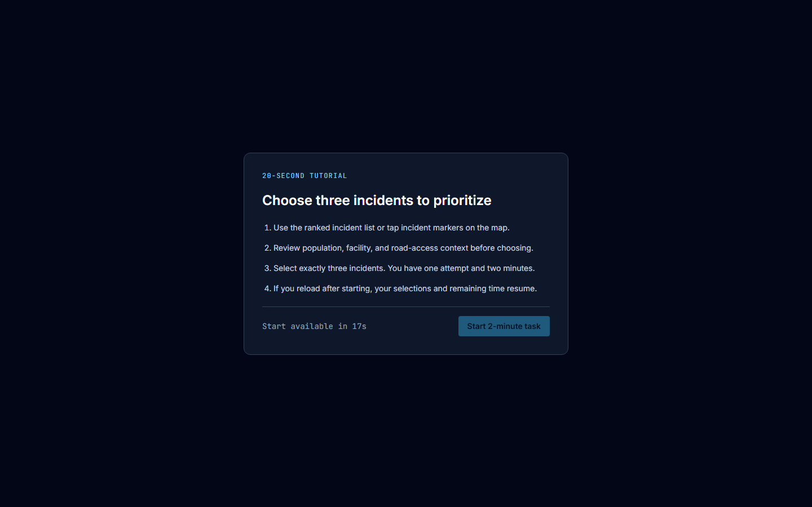
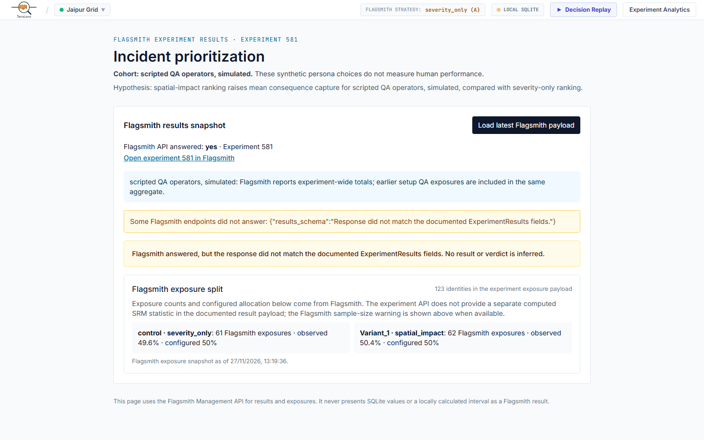
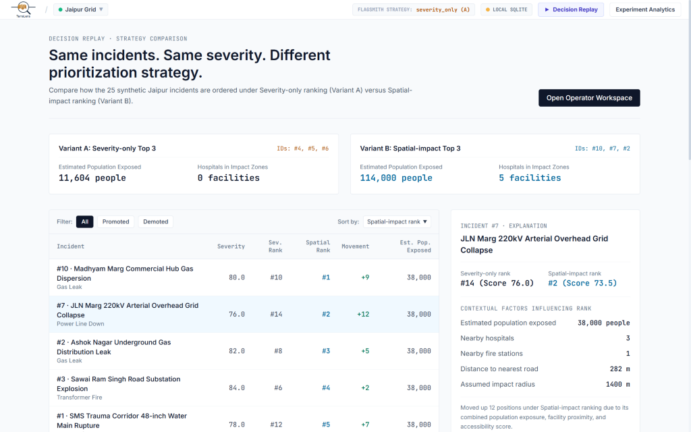
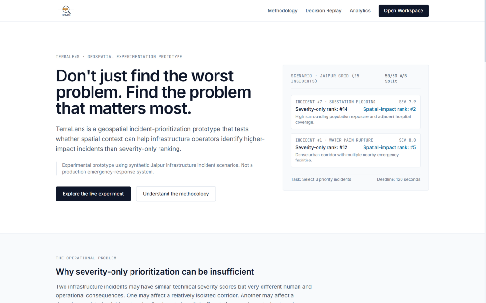
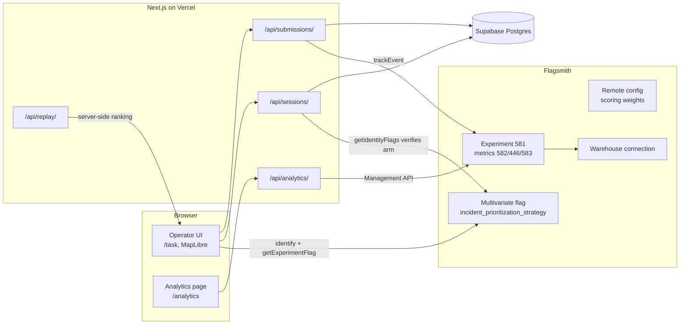
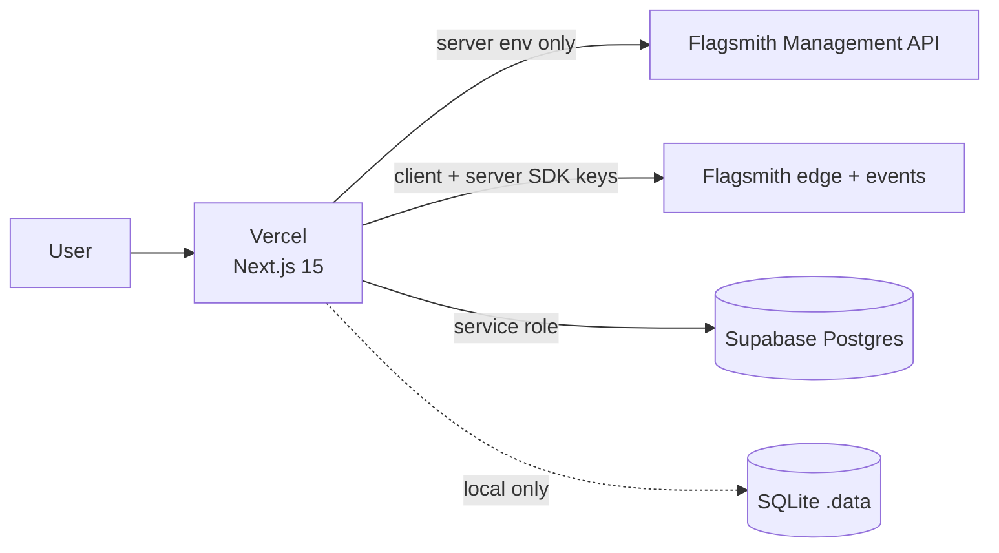
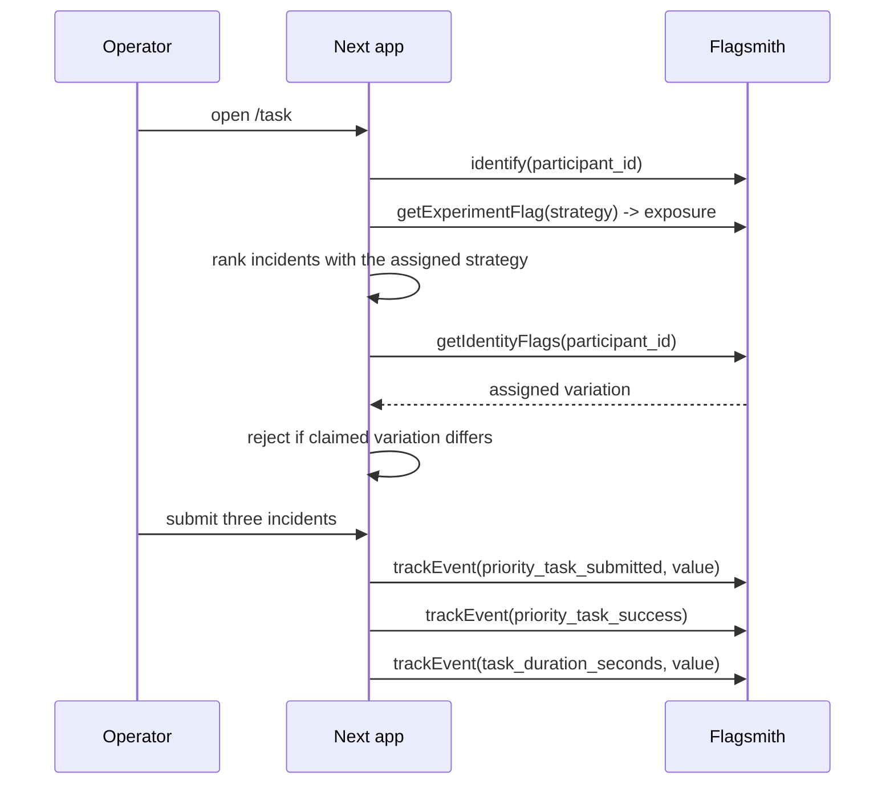
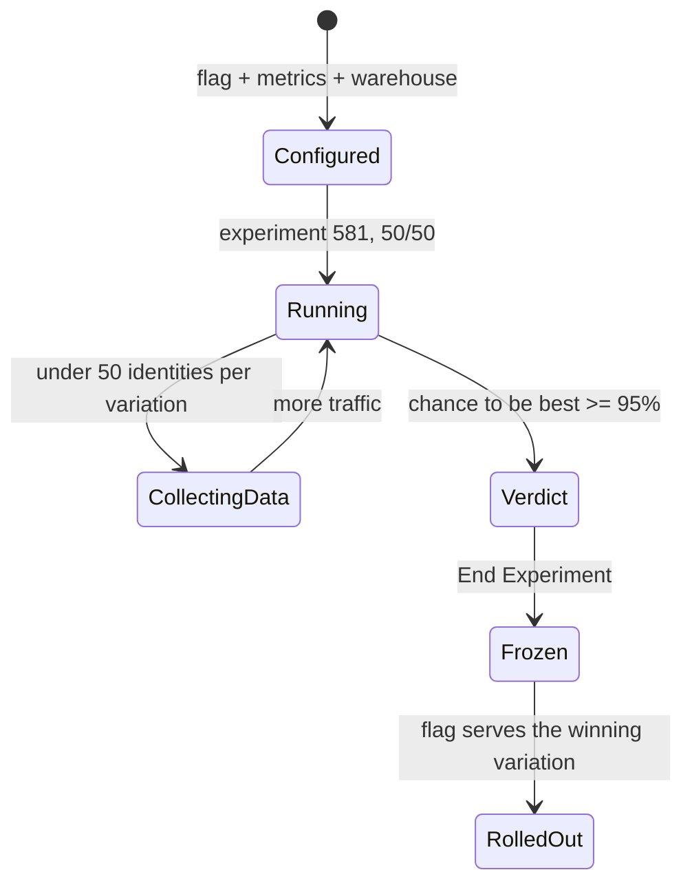
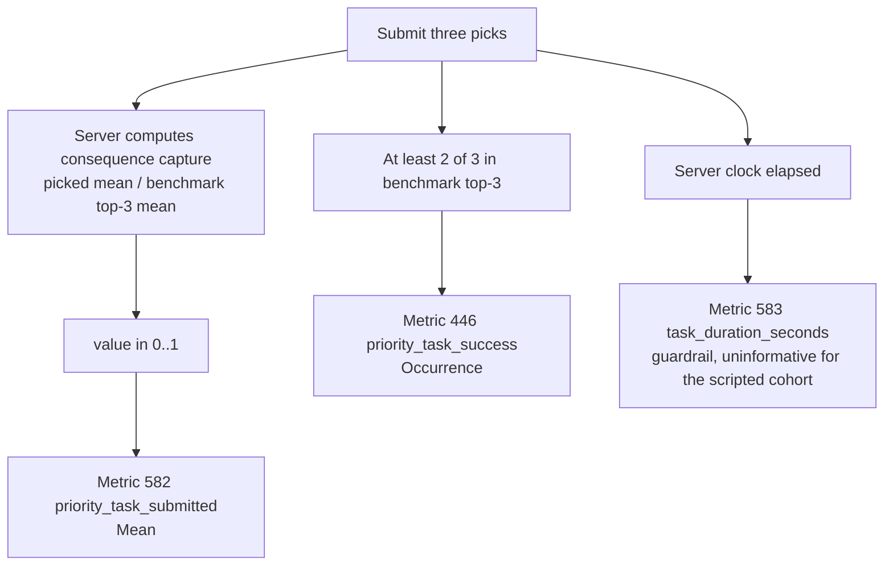

# TerraLens

[](https://github.com/MANASMATHUR/TerraLens/actions/workflows/ci.yml)
[](LICENSE)
[](.nvmrc)
[](https://wemakedevs.org/hackathons/flagsmith)

> **Pitch:** Spatial decision intelligence for emergency municipal operations—Flagsmith controls the incident prioritization algorithm, remote scoring weights, and telemetry pipeline.  
> **Demo Walkthrough Video:** [Coming Soon / Final Recording]  
> **Live Deployment:** [https://terra-lens.vercel.app](https://terra-lens.vercel.app)  

---

## Table of Contents

- [Screenshots](#screenshots)
- [What it is & The Problem](#what-it-is--the-problem)
- [Architecture](#architecture)
- [How the Experiment Works](#how-the-experiment-works)
- [Setup: Local Development](#setup-local-development)
- [Setup: Flagsmith Project](#setup-flagsmith-project)
- [Setup: Supabase](#setup-supabase)
- [Deployment: Vercel](#deployment-vercel)
- [How I Used Flagsmith](#how-i-used-flagsmith)
- [Results & Verdict](#results-and-verdict)
- [Decision Replay](#decision-replay)
- [Limitations](#limitations)
- [Troubleshooting](#troubleshooting)
- [License](#license)
- [Demo Script Summary](#demo-script-summary)

---

## Screenshots

| Operator Triage Workspace (`/task`) | Flagsmith Bayesian Analytics (`/analytics`) |
| :---: | :---: |
|  |  |
| **Strategy Comparison Replay (`/replay`)** | **Landing Overview (`/`)** |
|  |  |

---

## What it is & The Problem

TerraLens is a three-panel incident-prioritization GIS workspace for emergency municipal operations in a synthetic Jaipur monsoon scenario. It helps dispatchers and shift supervisors triage multiple concurrent infrastructure failures—such as water main bursts, electrical feeder trips, and structural collapses—under strict time constraints. Flagsmith assigns one of two ranking strategies remotely, reads real-time scoring weights from remote config, and ingests exposure and conversion telemetry.

During a storm, municipal control rooms frequently triage queues ordered by engineering severity alone. That ordering misses incidents whose spatial context creates high human consequence: a medium-severity fault beside a major trauma hospital impacts more lives than a severe line fault in an unpopulated field. When comparing the top three incidents under severity-only ranking versus spatial-impact ranking, severity-only protects an estimated 11,604 people and 0 hospitals, whereas spatial ranking protects an estimated 114,000 people and 5 hospitals (*population figures are capped at 38,000 per incident; the 114,000 total is a sum of capped values*).

---

## Architecture





---

## How the Experiment Works

Adding spatial consequence to incident prioritization raises the rate at which operators select benchmark top-three high-impact incidents compared with severity-only ranking. The continuous consequence capture metric acts as a manipulation check confirming that spatial scoring alters incident ordering as intended.

### Request Flow



### Experiment Lifecycle



### Metric Data Flow



---

## Setup: Local Development

### 1. Prerequisites
- Node.js 22 or later (`node -v >= 22.0.0`). Check with `.nvmrc`: `nvm use 22`.
- npm 10 or later.

### 2. Installation & Configuration
Clone the repository and install dependencies:
```bash
git clone https://github.com/MANASMATHUR/TerraLens.git
cd TerraLens
npm ci
```

Copy the environment template:
- **macOS / Linux:**
  ```bash
  cp .env.example .env.local
  ```
- **Windows (PowerShell):**
  ```powershell
  Copy-Item .env.example .env.local
  ```

In `.env.local`, configure the Flagsmith keys (see [Flagsmith Project Setup](#setup-flagsmith-project)). Keep keys local; `.env.local` is gitignored.

### 3. Recompute Server Benchmark & Launch
```bash
npm run benchmark:recompute
npm run dev
```

### 4. Health Verification
Open the three primary URLs to confirm healthy operation:
1. `http://localhost:3000/flags/health`: Verifies SDK initialization, strategy flag enrollment, and remote config weights.
2. `http://localhost:3000/task`: Main incident triage workspace. Begins 2-minute timer upon starting.
3. `http://localhost:3000/analytics`: Live Flagsmith Management API payload, exposure counts, and Bayesian inference verdict.

---

## Setup: Flagsmith Project

To reproduce or audit the Flagsmith setup from an empty project (TerraLens uses Project ID `55892`, Environment `Development`, Experiment `581`):

1. **Create Environment:** Create `Development`. Copy the **Client-side Environment Key** and **Server-side Environment Key** from Environment Settings.
2. **Create Multivariate Flag `incident_prioritization_strategy`:**
   - Control Value: `severity_only` (50% allocation).
   - Variation 1 (`Variant_1`): `spatial_impact` (50% allocation).
3. **Create Remote Config Flag `incident_prioritization_model_config`:**
   - Type: Enabled with JSON value:
     ```json
     {"population_weight":0.60,"facility_weight":0.30,"accessibility_weight":0.10,"mix_factor":0.45}
     ```
4. **Create Remote Fallback Flag `incident_consequence_fallback_enabled`:**
   - Type: Boolean, Value: `false`.
5. **Create Metrics:**
   - Primary: `priority_task_submitted` (Type: **Mean**, Metric ID `582`).
   - Secondary: `priority_task_success` (Type: **Occurrence**, Metric ID `446`).
   - Guardrail: `task_duration_seconds` (Type: **Mean**, Metric ID `583`).
6. **Connect Warehouse:** Under Environment Settings → Integrations, connect Flagsmith native warehouse pipeline (Connection ID `11688`).
7. **Create Experiment 581:**
   - Feature: `incident_prioritization_strategy`.
   - Allocation: 100% rollout, 50/50 split between Control and `Variant_1`.
   - Attach the three metrics above.
8. **Keys:** Copy an Organisation **Management API Key** (Format: `Api-Key ...`) into `FLAGSMITH_MASTER_API_KEY`.

> [!WARNING]
> While an experiment runs, flag configurations and variations are locked. Ending an experiment is irreversible.

---

## Setup: Supabase

Local runs store task sessions in SQLite at `.data/terralens_local.db`. On Vercel, serverless runtimes have a read-only filesystem; Supabase Postgres is used for persistent multi-user session state.

1. Create a project at [supabase.com](https://supabase.com).
2. Open the SQL Editor and run the two migration files in order:
   - `supabase/migrations/001_initial_schema.sql`
   - `supabase/migrations/002_add_simulated_sessions.sql`
3. Optional: execute `supabase/seed.sql` to load synthetic GIS points.
4. Copy `Project URL`, `anon public key`, and `service_role secret key` from Settings → API into:
   - `NEXT_PUBLIC_SUPABASE_URL`
   - `NEXT_PUBLIC_SUPABASE_ANON_KEY`
   - `SUPABASE_SERVICE_ROLE_KEY` *(Server-only; NEVER expose with `NEXT_PUBLIC_`)*
5. *Without Supabase configured:* The application automatically defaults to local SQLite persistence.

---

## Deployment: Vercel

1. Import the repository into Vercel. Framework preset: **Next.js**, Node.js Version: **22.x**.
2. Add the following Environment Variables across Production & Preview scopes:
   - `NEXT_PUBLIC_FLAGSMITH_ENVIRONMENT_KEY`
   - `FLAGSMITH_SERVER_KEY`
   - `FLAGSMITH_MASTER_API_KEY`
   - `FLAGSMITH_EXPERIMENT_ID` (`581`)
   - `NEXT_PUBLIC_FLAGSMITH_PROJECT_ID` (`55892`)
   - `NEXT_PUBLIC_SUPABASE_URL`
   - `NEXT_PUBLIC_SUPABASE_ANON_KEY`
   - `SUPABASE_SERVICE_ROLE_KEY`
3. Deploy. Open `/flags/health` and `/analytics` on the live URL to verify the warehouse reports `connected`.
4. *Known Constraints:* Vercel does not persist local SQLite writes across cold starts; Supabase credentials must be supplied.

---

## How I Used Flagsmith

| Flag, config, metric, or segment | Live value | Reason |
|---|---|---|
| Multivariate flag `incident_prioritization_strategy` | Control `severity_only`; keyed option `Variant_1` = `spatial_impact`; 50/50 | `getExperimentFlag` decides which ranking the app uses and records the exposure at flag evaluation. |
| Model config flag `incident_prioritization_model_config` | Enabled; JSON config with weights `0.60/0.30/0.10`, `mix_factor=0.45`. Currently identical to code defaults. | Reads scoring weights dynamically from remote config rather than hardcoding constants. |
| `severity_only` config defaults | Population/facility/accessibility weights `0/0/0`; `mix_factor=0.45`. | Preserves severity-only ordering. |
| `spatial_impact` config defaults | Weights `0.60/0.30/0.10`; `mix_factor=0.45`. | Adds population, facility, and accessibility context to severity. |
| Task config defaults | Select 3 incidents; success threshold 2 of 3; 120-second limit; benchmark v2.0; experiment ID 581. | Defines the task and server-side evaluation. |
| Boolean flag `incident_consequence_fallback_enabled` | Enabled: false. | Remote kill-switch: prevents missing spatial data from silently becoming an unguided treatment task. |
| Primary metric `priority_task_submitted` | Mean, higher is better; event value is server-computed `consequence_capture` in `[0,1]`. | Measures the mean consequence of selected incidents relative to the benchmark top-three mean, capped at 1. |
| Secondary metric `priority_task_success` | Occurrence, higher is better; emitted when at least 2 of 3 selected incidents match the benchmark top three. | Reports the binary benchmark success outcome separately. |
| Guardrail `task_duration_seconds` | Mean, lower is better; server-clock elapsed seconds. | Checks that the ranking does not slow task completion. |
| Segment targeting | None; full Development audience. | The experiment is not segment-targeted. Scripted IDs carry the `qa_sim_` prefix; this does not create a Flagsmith segment. |

---

## Results and Verdict

`/api/analytics` reads documented Flagsmith experiment results, exposures, and configuration endpoints directly from the Flagsmith Management API.

### Reconciled Experiment Cohorts

| Cohort / Source | Scope | Control (`severity_only`) | Treatment (`spatial_impact`) | Total | Role & Definition |
| :--- | :--- | :--- | :--- | :--- | :--- |
| **Flagsmith experiment 581** | Remote API (`/exposures/` and `/results/`) | **61** | **62** | **123** | Unique identities both exposed and evaluated in Flagsmith's warehouse. The same 123 identities appear in both endpoints (`excluded_identities: 0`); Flagsmith's warehouse reports a single ingested count. |
| **Local SQLite audit** | `.data/terralens_local.db` | **53** (50 completed) | **47** (45 completed) | **100** | Local audit log from initial batch, not an experiment result. Preserved intact for reproducibility. |

### Live Flagsmith Experiment Results (Experiment 581)

Queried live from the Flagsmith Management API:

- **Evaluated Identities (`n`):** 61 Control vs. 62 Variant_1 (123 evaluated in Flagsmith's warehouse; source: `/results/`)
- **Primary Metric (`priority_task_submitted`, Mean):** **0.610** Control vs. **0.890** Variant_1
  * **Flagsmith Bayesian Verdict:** **Winner declared** for `Variant_1` (past the 95% recommendation threshold). Observed lift: **+45.8%**, 95% Credible Interval: **[+22.7%, +68.8%]**, Chance to be best: **99.995%**.
  * *Methodological note: This graded increase reflects ranking fidelity by construction—confirming the spatial engine successfully surfaces high-consequence incidents to the top—while the binary arm evaluates whether operators selected them.*
- **Secondary Metric (`priority_task_success`, Occurrence):** **18.0%** (11/61) Control vs. **35.5%** (22/62) Variant_1
  * **Flagsmith Bayesian Result:** Observed lift: **+96.8%**, 95% Credible Interval: **[−28.5%, +222%]**, Chance to be best: **93.5%**. Inconclusive at this sample size due to credible interval crossing zero, but directionally positive (the behavioral signal).
- **Guardrail Metric (`task_duration_seconds`, Mean):** **2.61s** Control vs. **3.67s** Variant_1 (Chance: 0.21)
  * *Methodological note: Scripted execution latency (simulator setTimeout wait), not operator decision time; uninformative for cognitive cost in the simulated cohort. (A separate sanity check from one developer's manual test runs recorded 49.65s vs 55.99s, n small, not a human operator cohort).*
- **Rollout & Rollback:** See [docs/ship-the-winner.md](docs/ship-the-winner.md) for step-by-step instructions on promoting `spatial_impact` to 100% of operators or triggering the instant fallback kill-switch in Flagsmith.

---

## Decision Replay

The `/replay` route is a post-hoc explanatory view comparing how all 25 synthetic incidents shift between Severity-only (Variant A) and Spatial-impact (Variant B) prioritization.

> [!NOTE]
> The scripted QA cohort never loaded or interacted with `/replay`; it exists solely for operators and stakeholders to inspect ranking divergence post-task.
> Population numbers in `/replay` are capped at 38,000 per incident by the GIS generator; aggregate sums reflect sums of capped values.

---

## Limitations

- The 25 incidents, locations, and consequence contexts are synthetic; consequence capture is a prototype proxy, not a calibrated emergency-impact measure.
- **Population Cap Caveat:** `generate_jaipur_gis.py` clamps exposed population at 38,000 (`max(850, min(38000, pop_exposed))`) and index saturation at 32,000. Eight of the 25 incidents sit at exactly 38,000. As a result, the population component of the treatment ranking is flat across the largest incidents.
- The scripted personas and their incident selections are synthetic. This cohort cannot establish how human emergency operators would rank incidents. Human behavior requires a separately recruited operator study.
- Flagsmith returns experiment-wide aggregates. Earlier setup QA exposures on experiment 581 are included in the warehouse aggregate totals.
- Local SQLite task state serves as an offline fallback; it is not the experiment-results source.

---

## Troubleshooting

| Symptom | Cause | Remedy |
|---|---|---|
| App refuses to run experiment | Flagsmith edge or API unreachable / bad environment key | Verify `NEXT_PUBLIC_FLAGSMITH_ENVIRONMENT_KEY` in `.env.local` and check network access to `edge.api.flagsmith.com`. |
| `/analytics` empty or HTTP 503 | Missing `FLAGSMITH_MASTER_API_KEY` | Provide an Organisation Management API key in `.env.local`. |
| "Collecting data" in Flagsmith | Under 50 identities evaluated per arm | Flagsmith requires at least 50 identities per variant before computing Bayesian inference. Run traffic with `npm run simulate -- --target-per-arm 60`. |
| Warehouse status `disconnected` | Native warehouse not attached | In Flagsmith dashboard, ensure Warehouse integration is configured for the environment. |
| `EADDRINUSE: port 3000` | Stale Node process holding port 3000 | Run `Stop-Process -Id (Get-NetTCPConnection -LocalPort 3000).OwningProcess -Force` (PowerShell) or `kill -9 $(lsof -t -i:3000)` (Unix). |

---

## License

Open-source under the [MIT License](LICENSE).

---

## Demo Script Summary

For recording the 3-minute walkthrough video:
1. **Introduction (0:00–0:40):** Show problem of severity-only queues during urban disasters. Mention 11,604 vs 114,000 people protected (*disclose: capped at 38,000 per incident*).
2. **Flagsmith Governance (0:40–1:30):** Open Flagsmith dashboard showing multivariate flag `incident_prioritization_strategy`, remote config weights, and Experiment 581 setup.
3. **Operator Workspace (1:30–2:15):** Complete a live triage session at `/task` under remote assignment; show server-side verification rejecting client overrides.
4. **Bayesian Results & Rollout (2:15–3:00):** Open `/analytics` showing live Bayesian verdict (+45.8% lift, 99.995% chance to be best). Reference [docs/ship-the-winner.md](docs/ship-the-winner.md) for 100% rollout.
