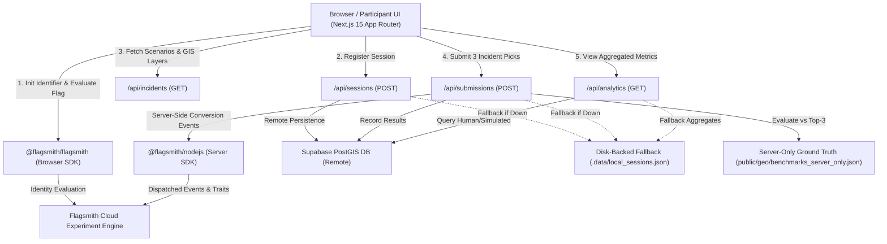

# Architecture Map & Critical Data Flows

## 1. System Components

## 2. Critical Data Flows

### A. Participant Initialization & Exposure Flow
1. Participant enters `/task`.
2. `getOrCreateParticipantId()` retrieves or creates a persistent UUID in browser storage (`terralens_participant_uuid`).
3. `initFlagsmith(pid)` identifies the user in Flagsmith Cloud and resolves `incident_prioritization_strategy`:
   - Arm A: `'severity_only'` (Control)
   - Arm B: `'spatial_impact'` (Treatment)
   - *Offline Fallback:* Deterministic ASCII hash % 2 partition.
4. Client posts `{ participant_id, variant, scenario_id }` to `/api/sessions`.
5. Server enforces server-clock timestamp (`started_at`) to prevent client clock manipulation.

### B. Scenario Presentation & Local Ranking Flow
1. Client requests `/api/incidents`.
2. Server serves 25 incidents with embedded spatial context (population exposure, facility counts, reachability index).
3. Client executes deterministic ordering via `rankIncidents(incidents, variant)`:
   - Control: $S_A = \text{severity\_score}$
   - Treatment: $S_B = \text{severity\_score} \times (0.55 + 0.45 \times (0.60P + 0.30F + 0.10A))$
4. MapLibre GL renders vector basemap (OpenFreeMap) alongside dynamic geospatial layers.

### C. Triage Decision & Scientific Evaluation Flow
1. Operator selects exactly 3 incidents and clicks "Confirm Priority Triage".
2. Client posts `{ participant_id, selected_incident_ids: [id1, id2, id3] }` to `/api/submissions`.
3. Server executes anti-tamper controls:
   - Rejects submissions outside $[1, 128]$ seconds.
   - Blocks duplicate submissions with HTTP 409 Conflict.
   - Validates that incident IDs are unique integers $\in [1, 25]$.
4. Ground truth disruption benchmark $I_{ref} = D \times T \times (0.70P + 0.30F)$ is loaded strictly on the server:
   - Top-3 critical ground truth: `[7, 18, 1]`.
5. Server scores selection:
   - Match $\ge 2$: `successful = true`
   - Precision@3: $\frac{\text{matches}}{3}$
   - NDCG@3: Discounted Cumulative Gain against optimal ideal rank.
6. Server records submission to Supabase or Disk Fallback.
7. Server dispatches telemetry to Flagsmith:
   - `priority_task_completed`
   - `priority_task_success` (conditional)
   - `priority_task_duration_seconds` (continuous)
8. Response payload returns metrics to client without leaking benchmark ground truth IDs.
